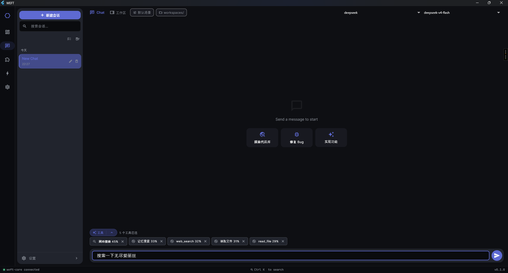
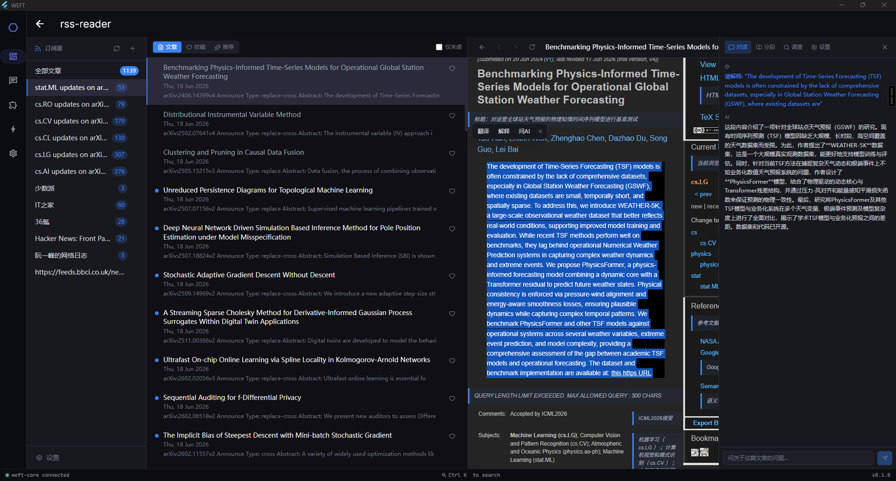
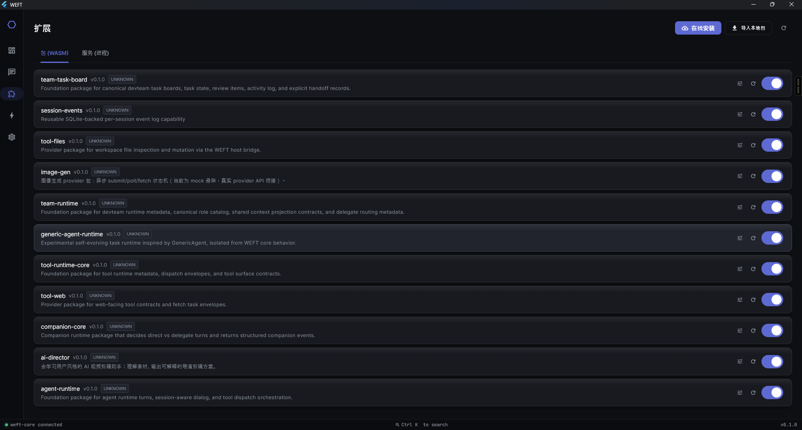
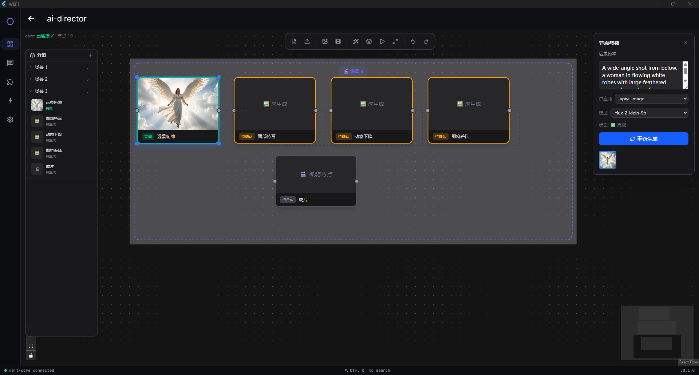

# Weft

**Inglés** · [简体中文](docs/README.zh-CN.md)

**Una plataforma modular de agentes de IA.** Un entorno de ejecución central en Rust expone una API compatible con OpenAI y un sistema de complementos basado en capacidades; el comportamiento se extiende mediante **paquetes** WASM y nativos; y un cliente de escritorio Flutter multiplataforma lo impulsa todo: orquestación de equipos multiagente, memoria persistente, uso de herramientas, habilidades, un lienzo de edición de video con IA y un lector de RSS mejorado con IA.

```
Cliente de escritorio Flutter  ⇄  weft-core (Rust, API compatible con OpenAI)  ⇄  paquetes (WASM / nativo)
```



> [!WARNING]
> **Weft es temprano, está en desarrollo activo y aún no es estable.** Actualmente se encuentra a mitad de camino en una remodelación del sistema de paquetes. Las APIs (los extremos HTTP, los contratos de capacidad y `packages/index.toml`) pueden y cambiarán sin previo aviso, algunos paquetes son experimentales y debes esperar imperfecciones. Trátalo como una vista previa para exploración, no como una dependencia de producción.

---

## Descarga

La forma más rápida de probar Weft es un paquete de escritorio precompilado desde la página de [**Lanzamientos**](https://github.com/ailiheizi/weft/releases): incluye el cliente y el proceso lateral `weft-core`, por lo que se inicia y ejecuta sin una instalación separada o una cadena de compilación. Agrega un proveedor de IA en la primera ejecución y estarás listo.

¿Prefieres compilar desde el código fuente? Consulta [Compilación](#build).

---

## Tabla de contenidos

- [Características principales](#highlights)
- [Descarga](#download)
- [Demostración de funciones](#feature-showcase)
- [Arquitectura](#architecture)
- [El sistema de capacidades](#the-capability-system)
- [Paquetes oficiales](#official-packages)
- [Estructura del repositorio](#repository-layout)
- [Compilación](#build)
- [Ejecución](#run)
- [Configuración](#configuration)
- [Documentación](#documentation)
- [Integración continua](#continuous-integration)
- [Acerca de](#about)
- [Licencia](#license)

---

## Características principales

- **Una API, muchos proveedores.** El núcleo habla el protocolo compatible con OpenAI (`/v1/chat/completions`) y enrutamiento a OpenAI, Anthropic, DeepSeek, OpenRouter y cualquier extremo compatible, con conmutación por error/rotación de claves API y enrutamiento enchufable.
- **Equipos multiagente.** Un orquestador de flujos de trabajo convierte un solo objetivo en un DAG de subtareas paralelas `depends_on`, los delega a agentes basados en roles (planificador, ejecutor, revisor…) y transmite en vivo la salida de cada agente.
- **Herramientas, utilizadas automáticamente.** Las herramientas integradas de shell, archivos, web, git y navegador se ofrecen al modelo a través de un contrato uniforme. Un `tool-selector` semántico (coincidencia de similitud coseno ONNX INT8, ~5–50 ms por consulta, sin GPU) ayuda a enrutar a la herramienta correcta en medio de la conversación sin cableado manual.
- **Memoria persistente y contexto proactivo.** Un entorno de ejecución de memoria curada mantiene el contexto entre sesiones; un motor de contexto ingesta señales y sugiere habilidades relevantes.
- **Extensible por diseño.** Todo lo que va más allá del enrutamiento crudo del LLM es un **paquete** (WASM, nativo o incrustado). Carga habilidades, registra servidores [MCP](https://modelcontextprotocol.io/), ejecuta extensiones JS, agenda trabajos cron.
- **Más que un cliente de chat.** Además de los agentes, Weft incluye un lector de RSS mejorado con IA, un lienzo de edición de video con IA (`ai-director`) y un navegador de espacio de trabajo incrustado, todos como paquetes en el mismo entorno de ejecución.
- **Productos construidos sobre la plataforma.** `weft-claw` (asistente de desarrollo de IA multirol) y `ai-director` (editor de video de IA con aprendizaje de estilo) se ensamblan declarativamente desde el mismo entorno de ejecución.

---

## Demostración de funciones

El cliente de escritorio está organizado como un shell de aplicación con una barra de navegación izquierda. Cada función a continuación es real y se asigna a una pantalla o una superficie de aplicación entregada por un paquete. Para el recorrido completo, consulta **[docs/FEATURES.md](docs/FEATURES.md)**.

### Chat con selección automática de herramientas

Chat con transmisión y multi-sesión que renderiza Markdown y produce artefactos, y selecciona la herramienta correcta (shell / archivos / web / git) para cada turno por sí solo. Las llamadas a herramientas se renderizan como burbujas de propósito específico (una burbuja de shell, una de archivos, una de búsqueda web) en lugar de JSON sin procesar, y las herramientas MCP (`mcp:server:tool`) reciben el mismo tratamiento.

### Selector de herramientas

Ve y controla exactamente a qué herramientas puede acceder un turno. El enrutamiento está respaldado por el paquete `tool-selector`: un selector semántico que clasifica las herramientas candidatas por similitud coseno utilizando inferencia local ONNX INT8 (unos pocos milisegundos por consulta, sin GPU). Agrega más herramientas instalando paquetes o registrando servidores MCP.

### Lector de RSS mejorado con IA

Un lector de feeds con una vista dedicada de artículos, **traducción en línea** de cualquier artículo y **seleccionar-para-preguntar-a-IA**: resalta un pasaje y pide a la IA que lo explique o resuma sin salir del lector.



### Administrador de paquetes

Explora los paquetes instalados, instala desde una fuente remota, importa desde el disco, configura la configuración por paquete y habilita/deshabilita, todo sin volver a compilar.



### Administrador de servicios residentes

Inicia, detiene y reinicia los servicios de larga duración (entorno de ejecución de memoria, motor de contexto, superficie del navegador…) que alimentan las partes siempre activas de Weft.

### Weft Claw: asistente de desarrollo de IA multirol

Un asistente de codificación ensamblado desde el mismo entorno de ejecución: describe lo que quieres y selecciona herramientas, escribe código y ejecuta las pruebas por sí solo, mostrando cada paso en lugar de una caja negra. Es un producto compuesto declarativamente desde las capacidades de agente, herramienta y entorno de ejecución de Weft, no una base de código separada.

### AI Director: el lienzo de IA

Un editor de video de IA con aprendizaje de estilo, presentado como un **lienzo infinito**. En lugar de una línea de tiempo lineal, el Director organiza el trabajo como un grafo de nodos generado por IA (un DAG de escenas y tomas) que puedes desplazar y ampliar: otro producto derivado del mismo entorno de ejecución, que prueba la afirmación de "una arquitectura, muchos productos".



> **La orquestación multiagente** se trata en detalle completo en [docs/FEATURES.md](docs/FEATURES.md).

---

## Arquitectura

Weft tiene tres capas: el **cliente**, el **entorno de ejecución central** y los **paquetes** que el núcleo carga.

```
┌─────────────────────────────┐
│  weft_client (Flutter)       │   Interfaz de escritorio Windows / macOS / Linux
│  chat · equipos · vista DAG ·│
│  aplicaciones · paquetes · conf│
└──────────────┬──────────────┘
               │  HTTP  (Compatible con OpenAI + API de gestión)
               │  127.0.0.1:17830  (bucle local, protegido por token)
┌──────────────▼──────────────┐
│  weft-core (servicio Rust)   │
│                              │
│  • API compatible con OpenAI  │  /v1/chat/completions, /v1/models
│  • API de gestión            │  /api/apps, /api/capabilities, /api/packages…
│  • Enrutador de proveedores │  multi-proveedor + conmutación/rotación de claves
│  • Registro de capacidades  │  vincula ids de capacidad → proveedores
│  • Cargador de paquetes (Extism) │ carga paquetes WASM + nativos
│  • Pipeline                 │  solicitud → transformación → proveedor → respuesta
└──────────────┬──────────────┘
               │  llamadas de capacidad
┌──────────────▼──────────────┐
│  Paquetes                    │
│  entorno-agente · memoria ·  │  WASM (Extism) o nativo, declarado en
│  herramientas · habilidades ·│  packages/index.toml (la autoridad de origen)
│  mcp · flujo de trabajo ·   │
│  entorno-equipo …           │
└─────────────────────────────┘
```

**Cliente ⇄ núcleo** es proceso a proceso a través de una API HTTP de bucle local, por lo que el mismo núcleo puede servir al cliente de escritorio, scripts o cualquier herramienta compatible con OpenAI. El núcleo carga paquetes de capacidades en tiempo de ejecución en lugar de compilarlos estáticamente.

Análisis detallado completo: **[docs/ARCHITECTURE.md](docs/ARCHITECTURE.md)**.

---

## El sistema de capacidades

Todo lo que el núcleo puede *hacer* más allá del enrutamiento crudo del LLM se modela como una **capacidad**: un id de cadena estable (por ejemplo, `agent.runtime`, `memory.store`, `tool.shell`, `workflow.orchestration`) que un paquete *proporciona* y que las aplicaciones *requieren*. `packages/index.toml` es la **autoridad de origen**: mapea cada capacidad al paquete que la proporciona, el tipo de paquete (`provider` / `product` / `foundation`) y su entorno de ejecución (`wasm` / `native` / `embedded` / `service`).

Al iniciar, el núcleo construye un registro de capacidades, resuelve las capacidades requeridas de cada aplicación a proveedores concretos (`bindings`) y despacha las llamadas de capacidad al paquete correcto. Esto es lo que permite que productos como `weft-claw` se ensamblen declarativamente desde entorno-agente + memoria + herramientas + habilidades sin codificar ninguno de ellos de forma rígida.

---

## Paquetes oficiales

Los 31 paquetes bajo `packages/official/` se agrupan en unas pocas familias. Consulta la [referencia de capacidades](docs/FEATURES.md#capabilities-reference) para la tabla completa de proporciona/requiere.

**Agente y orquestación**
| Paquete | Proporciona | Rol |
|---|---|---|
| `agent-core` | `agent.runtime`, `team.delegate` | Turnos de agente, diálogo consciente de sesión, despacho de herramientas |
| `workflow-orchestrator` | `workflow.orchestration` | Propuesta de tareas, verificación, orquestación de pasos DAG |
| `team-runtime` | `team.runtime`, `team.role.catalog`, `team.context.shared` | Roles de equipo, contexto compartido, enrutamiento de delegados |
| `team-task-board` | `team.taskboard`, `team.handoff` | Tablero de tareas + transferencia entre roles |
| `generic-agent-runtime` | `generic_agent.plan/run/verify/crystallize` | Entorno de ejecución de tareas autoevolutivo experimental |
| `workflow-template-devteam`, `workflow-template-creative` | plantillas de flujo de trabajo | Flujos de trabajo de equipo/creativos preconstruidos |

**Memoria y contexto**
| Paquete | Proporciona | Rol |
|---|---|---|
| `memory` / `memory-runtime` | `memory.store`, `memory.runtime`, `memory.curated` | Memoria curada persistente |
| `context-engine` | `context.engine`, `context.ingest`, `context.match` | Ingresa señales, sugiere habilidades |
| `prompt-system` | `prompt.system` | Gestión de prompts del sistema |
| `session-events` | `session.events` | Eventos del ciclo de vida de la sesión |

**Herramientas y extensión**
| Paquete | Proporciona | Rol |
|---|---|---|
| `tool-runtime-core` | `tool.runtime` | Contrato uniforme de despacho de herramientas |
| `tool-shell` / `tool-files` / `tool-web` / `tool-git` | `tool.shell/files/web/git` | Herramientas integradas |
| `tool-selector` | `tool.selector` | Enrutamiento semántico de herramientas (ONNX INT8, local) |
| `tool-browser` | `tool.browser` | Automatización de navegador vía chrome-devtools-mcp |
| `skills` | `ext.skills`, `skills.evolution/governance/review/maintenance` | Descubrimiento, carga y ejecución de habilidades |
| `mcp-client` | `ext.mcp` | Registrar servidores MCP, exponer sus herramientas |
| `js-extension-runtime` | `extension.runtime.js`, `skill.discovery` | Ejecutar extensiones JavaScript |
| `channels` | `channel.bridge` | Puente y enrutamiento de canales |
| `cron` | `scheduler.cron`, `maintenance.tick` | Trabajos programados |

**Productos y multimedia**
| Paquete | Rol |
|---|---|
| `weft-claw` | Asistente de desarrollo de IA multirol (producto) |
| `ai-director` | Asistente de edición de video de IA con aprendizaje de estilo (producto) |
| `rss-reader` | Lector de RSS/Atom mejorado con IA (suscribir, resumir, recomendar) |
| `ffmpeg-runtime`, `image-gen` | Multimedia: entorno ffmpeg, generación de imágenes |
| `ai-workspace-browser`, `creative-role-catalog` | Navegador de espacio de trabajo, catálogo de roles creativos |

> Las capacidades que **el propio núcleo** proporciona (no un paquete) incluyen `core.execution` (ejecución de comandos, con validación de ejecución simulada) y `core.files` (acceso a archivos del espacio de trabajo).

---

## Estructura del repositorio

```
core/                 Entorno de ejecución central en Rust (weft-core, weft, weft-sign, weft-rpc)
crates/               Crates de soporte (weft-code-runtime)
packages/
  sdk/                SDK compartido de paquetes (dependencia de ruta para todos los paquetes)
  official/           Los 31 paquetes oficiales
  installed/          Metadatos de paquetes instalados (manifiestos; wasm compilado por separado)
  index.toml          Autoridad de origen: mapeo capacidad → paquete
  weft-code/          Declaración de producto
clients/
  weft_client/        Cliente de escritorio Flutter (Windows/macOS/Linux)
docs/                 Recorrido de funciones, arquitectura, capturas de pantalla
config.example.toml   Plantilla de configuración de proveedores
.github/workflows/    CI + lanzamiento
scripts/              Ayudas de compilación (por ejemplo, build-wasm-packages.sh)
```

---

## Compilación

### Núcleo (Rust)

Requiere una cadena de herramientas Rust estable.

```bash
cargo build --workspace --release
```

Genera `weft-core` (el servicio) junto con `weft`, `weft-sign`, `weft-rpc`.

Los paquetes WASM se compilan por separado para el objetivo `wasm32-wasip1`:

```bash
cargo build -p <package> --target wasm32-wasip1 --release
```

### Cliente (Flutter)

Requiere el SDK de Flutter (`>=3.12`).

```bash
cd clients/weft_client
flutter pub get
flutter run -d windows   # o: macos / linux
```

---

## Ejecución

```bash
# 1. Configurar proveedores
cp config.example.toml config/config.toml
#    editar config/config.toml y agregar tus claves API del proveedor

# 2. Iniciar el núcleo (escucha en 127.0.0.1:17830 por defecto)
cargo run --release --bin weft-core

# 3. Iniciar el cliente de escritorio (se conecta al núcleo automáticamente)
cd clients/weft_client && flutter run -d windows
```

---

## Configuración

Copia `config.example.toml` a `config/config.toml` y completa las claves del proveedor:

```toml
[core]
host = "127.0.0.1"
port = 17830

[[providers]]
# name, base_url, api keys, ...
```

`config/config.toml` está ignorado por git: solo se confirma la plantilla de ejemplo.

---

## Documentación

- **[docs/FEATURES.md](docs/FEATURES.md)** — un recorrido completo, pantalla por pantalla, de cada función, con capturas de pantalla y una referencia completa de capacidades.
- **[docs/ARCHITECTURE.md](docs/ARCHITECTURE.md)** — cómo encajan el cliente, el núcleo y los paquetes: el pipeline de solicitud, resolución de capacidades, entornos de ejecución de paquetes y la API de gestión.

---

## Integración continua

Para conservar minutos de GitHub Actions, los flujos de trabajo no se activan en cada push:

- **CI** ([`.github/workflows/ci.yml`](.github/workflows/ci.yml)) — se ejecuta por activación manual. Compila y prueba el núcleo Rust (`cargo build --workspace`, `cargo test`) y analiza el cliente Flutter (`flutter pub get`, `flutter analyze`).
- **Lanzamiento** ([`.github/workflows/release.yml`](.github/workflows/release.yml)) — se ejecuta con una etiqueta `v*` (o activación manual): compila los binarios del núcleo, los paquetes WASM y la aplicación de escritorio empaquetada, y luego los publica como un Lanzamiento de GitHub.

---

## Acerca de

Weft es construido por un desarrollador autodidacta con base en Shenzhen. La idea en la que sigo apostando: la tecnología ya no es la barrera, lo es la capacidad de decisión. Yo decido la arquitectura y los compromisos; la IA acelera la implementación. Weft es mi intento en una apuesta así: una plataforma de IA donde cada capa es intercambiable, para que un solo entorno de ejecución pueda convertirse en muchos productos diferentes.

**Estoy abierto al trabajo** — backend / sistemas / ingeniería de IA / full-stack.

📮 ailiheizi@gmail.com · 🌐 [me.alhz.org](https://me.alhz.org)

---

## Licencia

Bajo licencia [Apache License 2.0](LICENSE).

Weft se basa en un excelente trabajo de código abierto, que incluye [Extism](https://extism.org/) (entorno de ejecución de complementos WASM), [ONNX Runtime](https://onnxruntime.ai/) (selección semántica de herramientas local) y [Flutter](https://flutter.dev/) (cliente de escritorio). Consulta el manifiesto de cada paquete y los manifiestos de dependencias (`Cargo.toml`, `pubspec.yaml`) para ver la lista completa.
